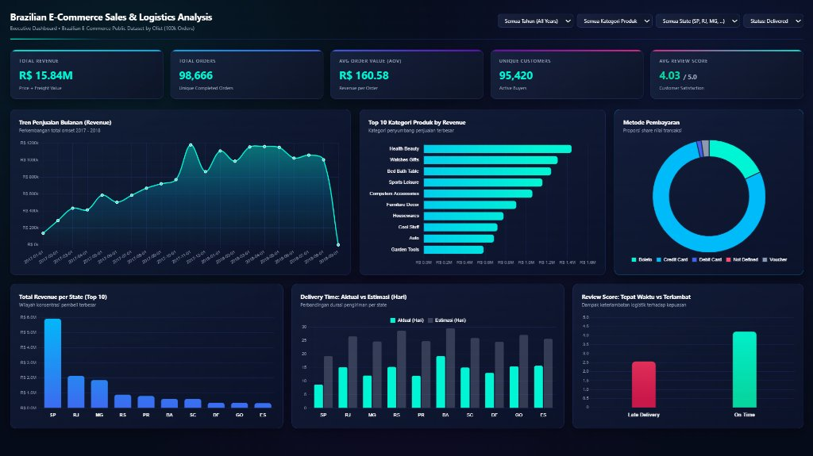

# 01 - Brazilian E-Commerce Sales & Logistics Analysis (Olist 100k Orders)

**Author:** Nofa Amandasari, S.Kom. (S1 Informatika — Universitas Muhammadiyah Semarang)

## Ringkasan Proyek
Analisis komprehensif terhadap **98.666 pesanan selesai** pada dataset publik Olist Brazilian E-Commerce (2017–2018) dengan total nilai transaksi **R$ 15.84M** dari **95.420 pelanggan unik**.

## Metrik Utama (KPI)
- **Total Revenue:** R$ 15.84M (Price + Freight Value)
- **Total Orders:** 98,666
- **Average Order Value (AOV):** R$ 160.58
- **Unique Customers:** 95,420
- **Average Review Score:** 4.03 / 5.0

## Struktur File
- `ecommerce_sales_analysis.ipynb` — Notebook eksplorasi data (EDA), pembersihan data, dan analisis statistik.
- `data_pipeline.py` — Script ETL & pemrosesan data transaksi Olist.
- `build_dashboard.py` — Script pembuatan agregasi data JSON dan komponen visualisasi dashboard.
- `dashboard_preview.html` — Dashboard interaktif HTML.
- `dashboard_data.json` — Output agregasi metrik penjualan dan logistik.
- `TABLEAU_GUIDE.md` — Dokumentasi struktur metrik dan panduan visualisasi.

## Temuan Utama (Key Insights)
1. **Konsentrasi Pasar:** Wilayah São Paulo (SP), Rio de Janeiro (RJ), dan Minas Gerais (MG) menyumbang porsi pendapatan terbesar.
2. **Kategori Produk Teratas:** *Health & Beauty*, *Watches & Gifts*, dan *Bed Bath Table* menjadi penyumbang omset tertinggi.
3. **Dampak Keterlambatan Logistik:** Pesanan yang tiba tepat waktu (*On Time*) memperoleh rata-rata **Review Score ~4.21/5.0**, sedangkan pesanan yang terlambat (*Late Delivery*) turun drastis ke **~2.54/5.0**.

