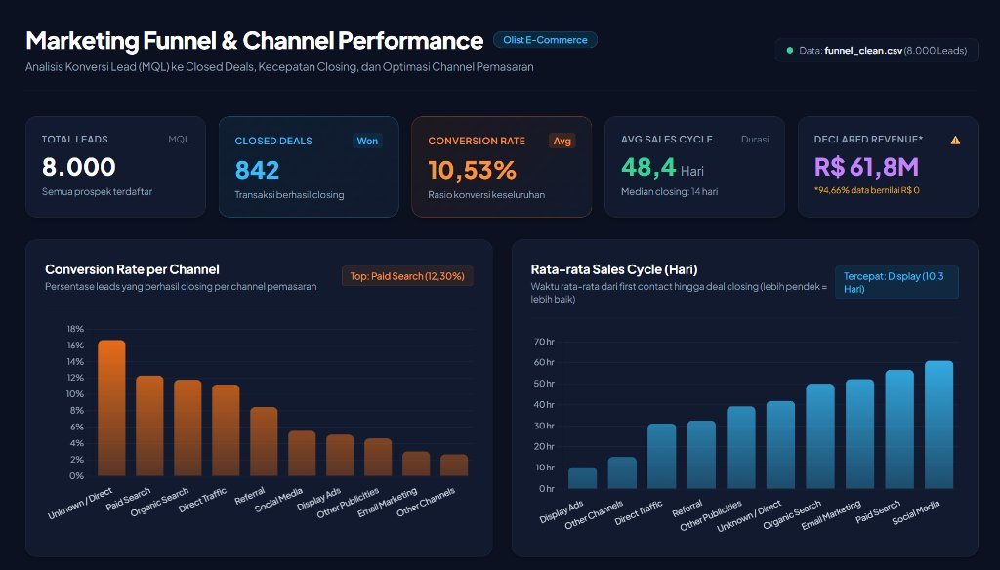

# 02 - Marketing Funnel & Channel Performance Analysis (Olist E-Commerce)

**Author:** Nofa Amandasari, S.Kom. (S1 Informatika — Universitas Muhammadiyah Semarang)

## Ringkasan Proyek
Evaluasi performa akuisisi prospek (*Marketing Qualified Leads* / MQL) hingga *Closed Deals* (Won) pada dataset pemasaran Olist (`funnel_clean.csv` — **8.000 Leads**).

## Metrik Utama (KPI)
- **Total Leads (MQL):** 8.000 prospek terdaftar
- **Closed Deals (Won):** 842 transaksi berhasil closing
- **Conversion Rate:** 10,53%
- **Average Sales Cycle:** 48,4 Hari (Median closing: 14 hari)
- **Declared Revenue:** R$ 61,8M (*Catatan kualitas data: 94,66% baris bernilai R$ 0*)

## Struktur File
- `marketing_funnel_portfolio.ipynb` — Notebook analisis konversi channel, distribusi durasi closing, dan data cleaning.
- `marketing_funnel_queries.sql` — Kueri SQL untuk agregasi funnel, conversion rate per channel, dan sales cycle.
- `funnel_clean.csv` — Dataset hasil pembersihan (8.000 baris MQL).
- `olist_marketing_qualified_leads_dataset.csv` & `olist_closed_deals_dataset.csv` — Dataset sumber.
- `dashboard.html` — Visualisasi dashboard interaktif.

## Temuan Utama (Key Insights)
1. **Channel Konversi Terbaik:** *Paid Search* mencatat rasio konversi tertinggi di antara channel terukur (**12,30%**), disusul *Organic Search* dan *Direct Traffic*.
2. **Kecepatan Closing (Sales Cycle):** *Display Ads* memiliki rata-rata siklus penutupan tercepat (**10,3 hari**), sementara *Social Media* membutuhkan waktu rata-rata paling lama (~60 hari).
