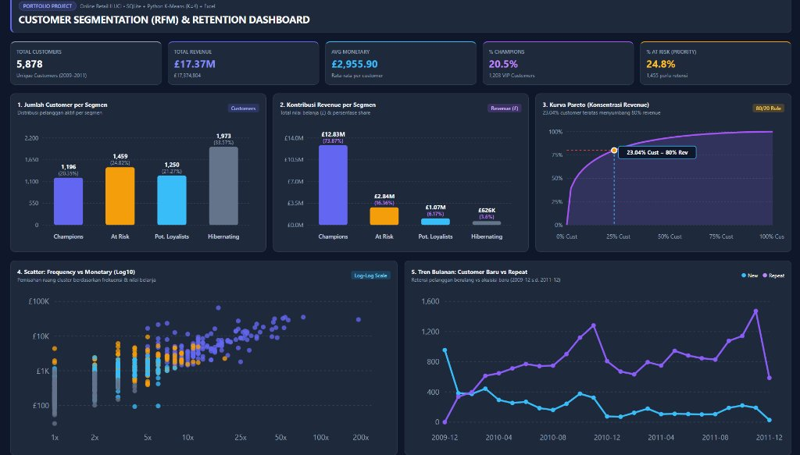

# 03 - Customer Segmentation (RFM) & Retention Dashboard (Online Retail II UCI)

**Author:** Nofa Amandasari, S.Kom. (S1 Informatika — Universitas Muhammadiyah Semarang)

## Ringkasan Proyek
Implementasi segmentasi pelanggan berbasis **Recency, Frequency, dan Monetary (RFM)** menggunakan **SQLite**, **Python Scikit-Learn K-Means Clustering (K=4)**, dan **Microsoft Excel** pada dataset transaksi *Online Retail II (UCI)* periode 2009–2011.

## Metrik Utama (KPI)
- **Total Customers:** 5,878 pelanggan unik
- **Total Revenue:** £17.37M (£17,374,804)
- **Average Monetary:** £2,955.90 per pelanggan
- **% Champions (VIP):** 20.5% (1,203 pelanggan VIP)
- **% At Risk (Priority):** 24.8% (1,455 pelanggan prioritas retensi)

## Struktur File
- `kaggle_rfm_segmentation.ipynb` — Notebook pemodelan RFM, transformasi Log10, evaluasi Elbow & Silhouette Score, dan K-Means (K=4).
- `run_pipeline.py` — Script pipeline integrasi SQLite dan pemrosesan data.
- `generate_visuals_and_excel.py` — Script pembuatan grafik analisis dan ekspor laporan Excel.
- `data/sql_exports/` — Hasil ekspor kueri SQL (`rfm_per_customer.csv`, `monthly_new_vs_repeat.csv`, `revenue_by_country.csv`).
- `reports/rfm_segmentation.xlsx` — Workbook laporan Excel hasil segmentasi RFM.
- `reports/rfm_dashboard.html` — Dashboard interaktif HTML.

## Temuan Utama (Key Insights)
1. **Konsentrasi Pareto 80/20:** **23,04% pelanggan teratas** menyumbang **80% total pendapatan** perusahaan.
2. **Kontribusi Segmen Champions:** Sebanyak 1.196 pelanggan (20,35%) di segmen *Champions* menghasilkan **£12.83M (73,87% total revenue)**.
3. **Prioritas Retensi (At Risk):** Sebanyak 1.459 pelanggan (24,82%) berada di segmen *At Risk* dengan nilai kontribusi **£2.84M (16,36% revenue)** yang memerlukan program retensi segera.

